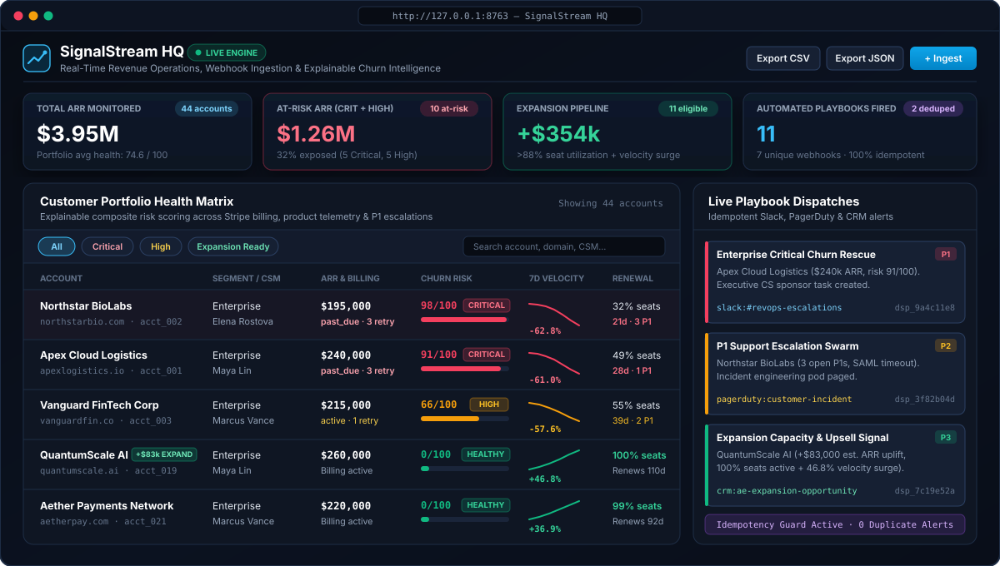
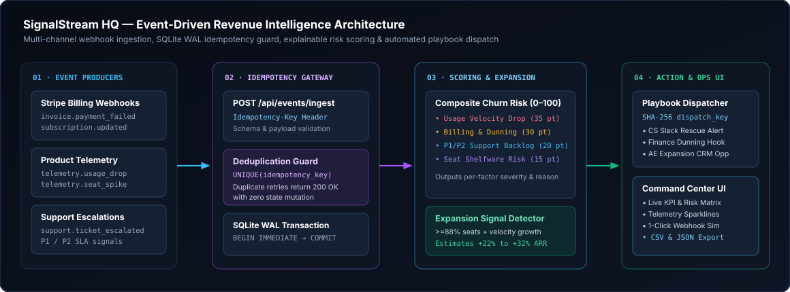

# SignalStream HQ — Real-Time Revenue & Customer Operations Intelligence

[](https://github.com/Nasim-U/signalstream-hq/actions/workflows/ci.yml)


**SignalStream HQ** is a full-stack revenue operations (RevOps) and customer health command center engineered for B2B SaaS teams. It ingests multi-channel webhooks across billing (`Stripe`), product telemetry, and customer support (`Zendesk`), computes an **explainable 0–100 Churn Risk & Account Health Score**, detects **Automated Expansion Opportunities**, and dispatches **idempotent alert playbooks** to Slack, PagerDuty, and CRM workflows.

Built on modern zero-dependency Node.js (`node:http`, `node:sqlite` in WAL mode, `node:test`) with an interactive dark-mode Operations Command Center UI—booting locally in under one second with zero external build tooling.

<p align="center">
  
</p>

---

## Architectural Highlights

<p align="center">
  
</p>

1. **Multi-Channel Idempotent Event Ingestion (`POST /api/events/ingest`)**
   - Processes Stripe-style billing webhooks (`invoice.payment_failed`, `invoice.paid`, `customer.subscription.updated`), product usage drops/spikes (`telemetry.usage_drop`, `telemetry.seat_spike`), and P1/P2 support escalations (`support.ticket_escalated`, `support.ticket_resolved`).
   - Enforces strict **database-level idempotency** (`UNIQUE(idempotency_key)` inside `BEGIN IMMEDIATE` SQLite WAL transactions) via request body or `Idempotency-Key` HTTP header. Duplicate webhook retries return `200 OK` (`deduplicated: true`) without mutating account metrics or double-firing alerts.
2. **Explainable Composite Risk & Expansion Scoring Engine (`src/scoring.js`)**
   - Every score is decomposed into four transparent, human-readable operational dimensions totaling **0–100 risk points** (`Health Score = 100 - Risk Score`), alongside an automated upsell capacity detector:

| Dimension | Max Risk Weight | Operational Signals Evaluated |
| :--- | :---: | :--- |
| **Product Usage Velocity** | `35 pts` | 7-day active telemetry velocity vs. 30-day weekly baseline (`-8%` softening to `<= -55%` contraction) |
| **Billing & Dunning Health** | `30 pts` | Past-due / uncollectible subscription state compounded by failed Stripe charge retry count |
| **P1 / P2 Support Backlog** | `20 pts` | Unresolved P1 critical incidents (`9 pts` each) and open P2 escalations (`3 pts` each) |
| **Seat Adoption & Renewal** | `15 pts` | Licensed seat shelfware ratio (`seats_active / seats_purchased`) weighted by `< 45d` renewal proximity |
| **Expansion Signal Detector** | *Upsell Uplift* | Flags low-risk (`<= 25`) active accounts at `>= 88%` seat capacity with `>= +8%` velocity growth (`+22%` to `+32%` est. ARR) |

3. **Configurable Playbook Router & Deterministic Dispatch Keys (`src/playbooks.js`)**
   - Evaluates active routing rules on every state transition (e.g., *Enterprise Critical Churn Rescue*, *Automated Billing & Dunning Recovery*, *P1 Support Escalation Swarm*, *Expansion Capacity & Upsell Signal*).
   - Computes deterministic SHA-256 `dispatch_key` (`dsp_<16-hex>`) hashes from `(rule_id, account_id, trigger_event_key)` so downstream Slack/CRM webhooks never double-fire.
4. **Interactive Operations Command Center UI (`public/`)**
   - **Live Portfolio Summary Strip:** Monitors `$3.92M` seeded ARR across **44 B2B SaaS accounts** (Enterprise, Mid-Market, Growth), At-Risk ARR exposure, Expansion Pipeline uplift, and deduplicated webhook counters.
   - **Filterable Matrix & Slide-Over Intelligence Drawer:** Filter by risk tier, segment, CSM owner, or search query. Click any account to inspect its **8-week SVG telemetry sparkline**, per-factor risk weights, **one-click live webhook simulator** (including duplicate key replay testing), and manual playbook runner.
   - **Instant Reporting:** One-click filtered **CSV** and **JSON** portfolio exports.

---

## Quickstart

**Prerequisites:** Node.js `v22.5+` (`v24 LTS` recommended; uses built-in `node:sqlite` and `node:test` with zero `npm install` overhead).

```bash
# 1. Clone the repository
git clone https://github.com/Nasim-U/signalstream-hq.git
cd signalstream-hq

# 2. Launch the Command Center (auto-seeds 44 SaaS accounts on first boot)
npm start
# -> Live at http://127.0.0.1:8763

# 3. Run the automated unit & HTTP integration test suite
npm test
```

To reset and re-seed the SQLite database from the CLI at any time:

```bash
npm run seed
```

---

## REST API Reference

| Method | Endpoint | Description |
| :--- | :--- | :--- |
| `GET` | `/api/health` | Service health check and monitored account count |
| `GET` | `/api/summary` | Portfolio KPIs (Total ARR, At-Risk ARR, Expansion Pipeline, tier breakdown, dedup stats) |
| `GET` | `/api/accounts` | Filterable account list (`?riskTier=Critical&segment=Enterprise&owner=...&search=...`) |
| `GET` | `/api/accounts/:id` | Full account intelligence detail, 8-week sparkline array, risk factors, recent events & dispatches |
| `GET` | `/api/accounts/export` | Downloadable portfolio report (`?format=csv` or `?format=json`, supports all table filters) |
| `POST` | `/api/events/ingest` | Idempotent multi-channel webhook ingestion (`201` new, `200` deduplicated retry) |
| `GET` | `/api/playbooks/dispatches` | Recent automated & manual playbook alert dispatches (`?limit=25`) |
| `GET` | `/api/playbooks/rules` | List configurable playbook routing rules and enabled status |
| `PATCH` | `/api/playbooks/rules/:id` | Enable or pause an automated routing rule (`{ "enabled": false }`) |
| `POST` | `/api/playbooks/run` | Trigger a targeted or auto-matched playbook for an account with idempotency key support |
| `POST` | `/api/admin/reset` | Reset and re-seed the 44-account baseline SaaS portfolio |

### Example: Idempotent Webhook Ingestion

```bash
curl -X POST http://127.0.0.1:8763/api/events/ingest \
  -H "Content-Type: application/json" \
  -H "Idempotency-Key: evt_stripe_inv_99481" \
  -d '{
    "account_id": "acct_011",
    "source": "stripe",
    "event_type": "invoice.payment_failed",
    "payload": {
      "invoice_id": "in_01HXYZ",
      "amount_due": 11800,
      "attempt_count": 2
    }
  }'
```

Re-running the exact command above returns `HTTP 200` with `"deduplicated": true`, preserving exact risk score integrity and blocking duplicate Slack/CRM dispatches.

---

## Project Structure

```text
signalstream-hq/
├── .github/workflows/ci.yml   # GitHub Actions CI (SVG XML check + test suite + E2E smoke test)
├── docs/
│   ├── ui-preview.svg         # Command Center UI preview graphic
│   └── pipeline-flow.svg      # Event ingestion & scoring architecture diagram
├── public/
│   ├── index.html             # Full-stack Operations Command Center markup
│   ├── styles.css             # Dark-mode RevOps interface styling
│   └── app.js                 # Interactive filters, SVG sparklines, drawer & webhook simulator
├── src/
│   ├── config.js              # Environment configuration, risk thresholds & default playbook rules
│   ├── scoring.js             # Explainable 4-factor churn risk & expansion opportunity engine
│   ├── playbooks.js           # Rule matcher & deterministic SHA-256 dispatch key builder
│   ├── db.js                  # SQLite WAL store, transactional ingestion & CSV exporter
│   ├── seed.js                # 44-account B2B SaaS portfolio & initial webhook seeder
│   ├── app.js                 # Native HTTP router & REST API controller
│   └── server.js              # Application entrypoint
└── test/
    ├── scoring.test.js        # Risk factor weights, boundaries & expansion eligibility tests
    ├── playbooks.test.js      # Rule matching & idempotent deduplication unit tests
    └── api.test.js            # End-to-end HTTP integration & lifecycle tests
```

---

## License

Released under the [MIT License](LICENSE). Built by **Nasim Uddin** ([@Nasim-U](https://github.com/Nasim-U)).
