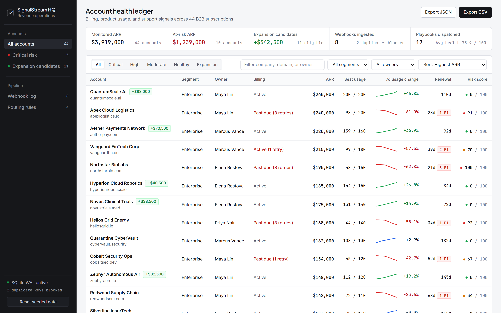
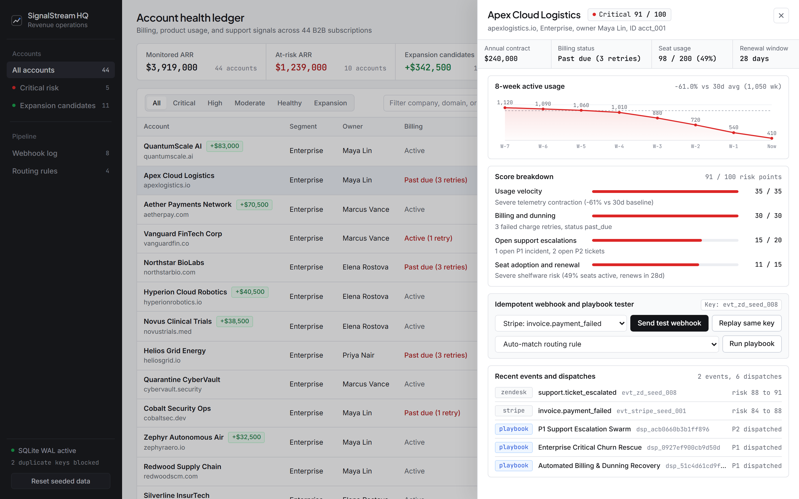

# signalstream-hq

[](https://github.com/Nasim-U/signalstream-hq/actions/workflows/ci.yml)

`signalstream-hq` is a Node.js and SQLite web application that tracks B2B subscription health across billing, product telemetry, and support tickets. It accepts Stripe, Zendesk, and usage webhooks, deduplicates retries in SQLite WAL, computes a 0 to 100 churn risk score, and exports filtered account ledgers as CSV or JSON.



Selecting an account row opens a slide-over detail sheet with an 8-week active usage chart, the four-factor score breakdown, an idempotent webhook replay tester, and the recent event and dispatch log.



## How ingestion and scoring work

`src/db.js` opens `data/signalstream.db` with `PRAGMA journal_mode = WAL` and `PRAGMA foreign_keys = ON`. When `POST /api/events/ingest` receives a payload, `ingestEvent()` checks `ingested_events` for an existing `idempotency_key` taken from either the JSON body or the `Idempotency-Key` HTTP header.

If the key already exists, the store increments `duplicates_blocked` in `system_metrics` and returns `HTTP 200` with `"deduplicated": true`. Neither the account row nor `playbook_dispatches` changes.

If the key is new, `ingestEvent()` starts a `BEGIN IMMEDIATE` transaction and runs three steps atomically:

1. Mutates the account state for the event type and recomputes scores via `computeAccountIntelligence()` in `src/scoring.js`.
2. Inserts the event into `ingested_events`, where `UNIQUE(idempotency_key)` blocks duplicate writes.
3. Evaluates enabled rules in `src/playbooks.js` and inserts matching alerts into `playbook_dispatches`. `buildDispatchKey()` hashes `rule_id`, `account_id`, and `trigger_event_key` with SHA-256 into a deterministic `dsp_<16-hex>` key enforced by `UNIQUE(dispatch_key)`.

`src/scoring.js` calculates `risk_score` as the sum of four capped factors totaling 100 points, with `health_score` equal to `100 - risk_score`:

| Factor | Max points | Calculation in `src/scoring.js` |
| :--- | ---: | :--- |
| Usage velocity | 35 | Compares `usage_7d` against `usage_30d_weekly_avg`. Contractions of `<= -55%` add 35 points, `<= -35%` add 27, `<= -20%` add 18, and `<= -8%` add 9. |
| Billing and dunning | 30 | Adds 30 points when `billing_status` is `uncollectible` or `canceled`, `min(30, 14 + failed_payments * 6)` when `past_due`, or `min(24, failed_payments * 8)` on active accounts with failed retries. |
| Open support escalations | 20 | Adds `min(20, open_p1_tickets * 9 + open_p2_tickets * 3)`. |
| Seat adoption and renewal | 15 | Computes `seats_active / seats_purchased`. Ratios below `0.35` add 12 points, below `0.55` add 8, and below `0.70` add 4, plus 3 points when `renewal_days <= 45`. |

`src/config.js` maps `75` to `100` to `Critical`, `50` to `74` to `High`, `28` to `49` to `Moderate`, and `0` to `27` to `Healthy`. `computeAccountIntelligence()` sets `expansion_eligible` to `true` with a `22%` or `32%` ARR uplift estimate when `risk_score <= 25`, `billing_status` is `active`, `failed_payments` is `0`, `open_p1_tickets` is `0`, `seat_utilization >= 0.88`, and `usage_velocity_pct >= 8`.

## Run locally

Install Node.js `22.5.0` or newer. Node.js `24` LTS is recommended. The server uses built-in `node:http`, `node:sqlite`, and `node:test` modules with zero external runtime dependencies.

1. Clone the repository and enter the directory:

```bash
git clone https://github.com/Nasim-U/signalstream-hq.git
cd signalstream-hq
```

2. Start the server on port `8763`. On first startup, `src/seed.js` populates 44 B2B accounts and initial webhook history if `data/signalstream.db` is empty:

```bash
npm start
```

Open `http://127.0.0.1:8763` in your browser.

3. Run the unit and HTTP integration test suite:

```bash
npm test
```

4. Reset and re-seed `data/signalstream.db` from the command line at any time:

```bash
npm run seed
```

## HTTP endpoints

`src/app.js` serves the static frontend from `public/` and exposes these routes:

| Method | Path | Behavior |
| :--- | :--- | :--- |
| `GET` | `/api/health` | Returns service status and monitored account count. |
| `GET` | `/api/summary` | Returns portfolio ARR totals, risk tier counts, webhook counters, and distinct owners. |
| `GET` | `/api/accounts` | Lists accounts filtered by `riskTier`, `segment`, `owner`, `search`, `expansionOnly`, `sortBy`, and `sortDir`. |
| `GET` | `/api/accounts/:id` | Returns one account with its 8-week `usage_history`, `risk_factors`, recent events, and dispatches. |
| `GET` | `/api/accounts/export` | Exports filtered accounts when `format=csv` or `format=json` is passed. |
| `GET` | `/api/events` | Lists recent rows from `ingested_events` up to the `limit` query parameter. |
| `POST` | `/api/events/ingest` | Ingests a webhook, returning `201` on first delivery and `200` on a duplicate `idempotency_key`. |
| `GET` | `/api/playbooks/dispatches` | Lists recent rows from `playbook_dispatches` up to the `limit` query parameter. |
| `GET` | `/api/playbooks/rules` | Lists the four routing rules and their `enabled` boolean state. |
| `PATCH` | `/api/playbooks/rules/:id` | Updates a routing rule with `{ "enabled": true }` or `{ "enabled": false }`. |
| `POST` | `/api/playbooks/run` | Dispatches a specified or auto-matched rule for `account_id` with optional `idempotency_key`. |
| `POST` | `/api/admin/reset` | Clears and re-seeds the 44-account dataset. |

To send a test Stripe webhook and verify deduplication, run the same `curl` command twice:

```bash
curl -X POST http://127.0.0.1:8763/api/events/ingest \
	-H "Content-Type: application/json" \
	-H "Idempotency-Key: evt_stripe_inv_99481" \
	-d '{
		"account_id": "acct_011",
		"source": "stripe",
		"event_type": "invoice.payment_failed",
		"payload": {
			"invoice_id": "in_01HXYZ",
			"amount_due": 11800,
			"attempt_count": 2
		}
	}'
```

The first call returns `HTTP 201` with `"deduplicated": false` and updates `acct_011`. Repeating the command with the same `Idempotency-Key` returns `HTTP 200` with `"deduplicated": true` without changing `risk_score` or firing duplicate dispatches.

## Project layout

Regenerate the tracked file list with `git ls-files`:

```text
.github/workflows/ci.yml
.gitignore
LICENSE
README.md
docs/account-drawer.png
docs/account-ledger.png
package.json
public/app.js
public/index.html
public/styles.css
src/app.js
src/config.js
src/db.js
src/playbooks.js
src/scoring.js
src/seed.js
src/server.js
test/api.test.js
test/playbooks.test.js
test/scoring.test.js
```

## License

[MIT](LICENSE)
